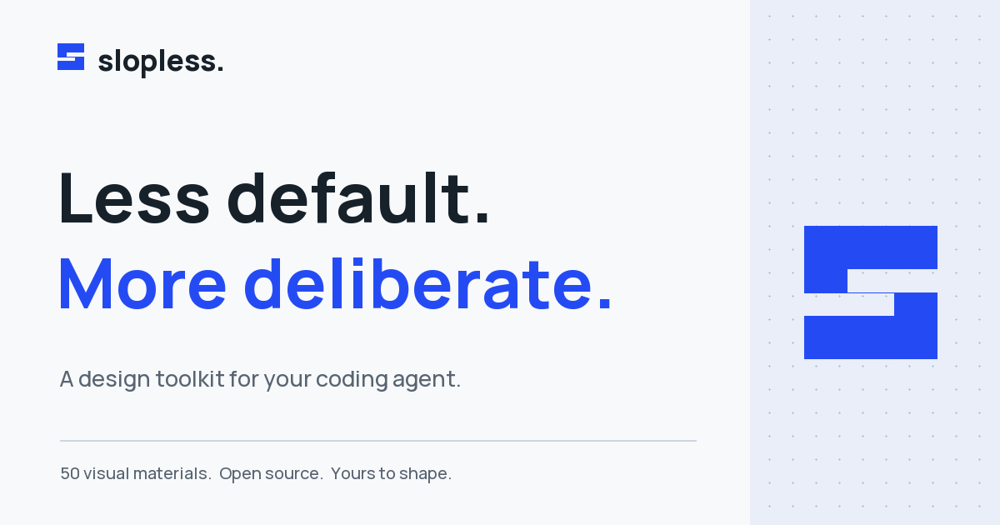

# Slopless

**Less default. More deliberate.** A design toolkit for coding agents: fifty visual materials, a job-first workflow, and checks for the page you actually made.

[Website](https://arbabtalha.github.io/slopless/site/) · [Setup guide](https://arbabtalha.github.io/slopless/site/docs/) · [Materials](https://arbabtalha.github.io/slopless/site/#materials) · [Issues](https://github.com/arbabtalha/slopless/issues)



## Install

Requires **Node.js 18+**, Git, and a supported coding agent.

```sh
npx skills add arbabtalha/slopless -g
```

Leave off `-g` for a project-local install, or add `--agent claude-code`, `codex`, `cursor`, or `opencode` to select one agent. No Slopless account or provider key is needed to install.

| Agent | Invoke |
| --- | --- |
| Claude Code | `/slopless <your idea>` |
| Codex | `$slopless <your idea>` |
| Cursor / OpenCode | `/slopless <your idea>` |

From a checkout:

```sh
git clone https://github.com/arbabtalha/slopless.git
cd slopless
node skills/slopless/scripts/install.mjs --claude --dry-run
node skills/slopless/scripts/install.mjs --claude
```

Other targets: `--codex`, `--cursor`, or `--opencode --copy`. Reinstallation replaces only the selected Slopless copy. `--remove` removes installed Slopless copies, not unrelated skills.

For a Claude Code plugin, add the repository as a marketplace:

```text
/plugin marketplace add arbabtalha/slopless
/plugin install slopless@slopless
/slopless:slopless a page for my project
```

You can also add an absolute local checkout path as a marketplace. The local skill installer works independently of marketplace support.

## What it does

- **Start with the job.** A booking page books; a product page explains and sells. The agent reads the project and asks for actual content rather than inventing facts.
- **Choose a material.** Fifty palettes, type systems, surfaces, and textures provide a direction, not a rigid layout. Name a theme or ask for a custom system.
- **Build with intent.** Review the first screen before extending the page. Keep an existing product's content and interactions unless a change was requested.
- **Check the output.** A zero-dependency static linter catches common design reflexes. Optional real-browser checks measure contrast, focus, responsive layout, and other rendered details.

```text
/slopless a booking page for a small ceramics workshop
/slopless a pricing page for my developer tool, custom
/slopless redesign ./src/app
/slopless redesign ./index.html, keep the layout
/slopless audit ./index.html
```

An audit reports; it does not redesign. Automated checks assist review, not guarantee perfect design or accessibility.

## Tools

```sh
# Static checks (no npm dependencies required)
node skills/slopless/scripts/sloplint.mjs ./index.html
node skills/slopless/scripts/sloplint.mjs ./src --json

# Keep a before record and check a requested redesign
node skills/slopless/scripts/sloplint.mjs ./index.html --before
node skills/slopless/scripts/sloplint.mjs ./index.html --kept

# Optional browser checks: install puppeteer-core and Chrome/Chromium
npm install -g puppeteer-core
node skills/slopless/scripts/sloplint.mjs ./index.html --render

# Optional Claude Code edit-time hook; inspect before installing
node skills/slopless/scripts/install-hook.mjs --print
node skills/slopless/scripts/install-hook.mjs
```

`CHROME_PATH` selects the browser binary. `SLOPLESS_PUPPETEER` selects a directory from which `puppeteer-core` can be resolved. See [the setup guide](site/docs/index.html) for installation, privacy, and troubleshooting.

### Existing project state

Slopless does not automatically delete old skills or edit legacy hooks. New runs use `.slopless/`. An explicit copy-only migration is available:

```sh
node scripts/migrate.mjs --project /path/to/project --dry-run
node scripts/migrate.mjs --project /path/to/project
```

Existing destination files are skipped, source files are never removed, and symlinks are rejected. Older browser environment variable names and predecessor CSS stamps are accepted for compatibility. See [migration details](site/docs/index.html#migration).

## Website and development

The website is plain HTML, CSS, and JavaScript. No framework, build service, analytics, account system, or application backend is required. All fifty theme demos and twenty-one example pages are included. Examples are demonstrations, not customers or testimonials.

```sh
npm run serve       # http://localhost:4173; listens on 0.0.0.0 for previews
npm run check       # references, themes, index, site links, branding and tests
npm test            # unit/integration tests; browser tests skip without configuration
node scripts/build-site.mjs  # rebuild the static catalog after a theme-index change
```

Free hosting uses the repository's **GitHub Pages** project address. Root `index.html` forwards visitors to `site/`. The checked-in `.nojekyll` keeps static files intact. `vercel.json` also supports serving `site/` from Vercel; no Vercel account or domain is provisioned by this repository. Canonical sharing URLs use the GitHub Pages address.

For browser QA, install `puppeteer-core` locally or in a separate tools directory. Set `SLOPLESS_PUPPETEER` and `CHROME_PATH`, then run `npm run test:browser`. To enable the renderer regression tests as well, set `SLOPLESS_TEST_PUPPETEER` to the resolved Puppeteer module file and `SLOPLESS_TEST_CHROME` to the browser binary. CI runs these with a real browser.

Original brand images can be rebuilt with `python3 scripts/brand-assets.py` after installing `scripts/requirements-assets.txt`. This is asset-maintenance tooling, not a runtime dependency.

## Optional services and costs

The toolkit itself is MIT-licensed and free. Your agent subscription and optional API services keep their own terms and costs.

- Photo downloads contact Wikimedia Commons. Individual photo licenses and credits must be preserved.
- Optional image generation uses `TOGETHER_API_KEY` to contact Together's API. The key is not needed for static checks; paid requests are never part of the verification suite.
- Your coding agent uses its own provider. Included example pages may load external fonts and photographs. The new homepage serves its fonts and screenshots locally.
- Keep credentials out of Git and browser JavaScript. Local runtime directories and environment files are ignored.

## Source, license, and independence

Independently maintained by [arbabtalha](https://github.com/arbabtalha). This project builds on open-source work; original copyright notices are preserved. See [LICENSE](LICENSE), [NOTICE.md](NOTICE.md), and [website credits](site/credits/index.html) for provenance, photo licensing, and font notices. No affiliation or sponsorship is implied.
